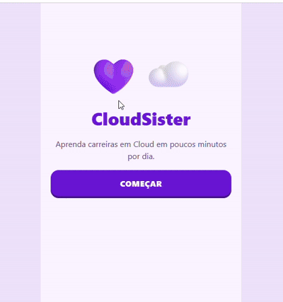
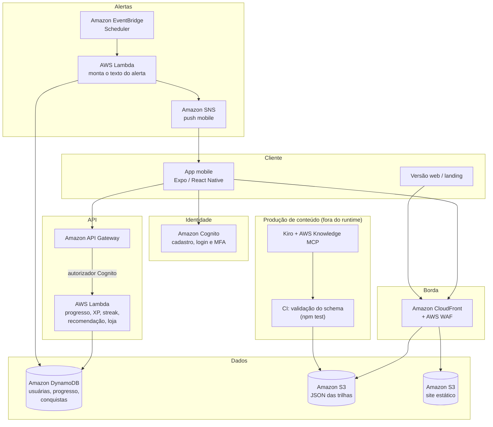

# CloudSister 💜☁️

Protótipo de um app mobile que orienta e capacita mulheres para carreiras em Cloud. A experiência segue o estilo do Duolingo: aprendizado diário, rápido e gamificado, com pílulas de poucos minutos, XP, ofensiva (streak) e alertas para manter o ritmo.

> Projeto criado no **Hackathon Women in Cloud 2026**, desenvolvido com o **Kiro** em **3 horas**.
>
> ### Demonstração do CloudSister



---

## Sumário

- [Contexto do hackathon](#contexto-do-hackathon)
- [O que é o CloudSister](#o-que-é-o-cloudsister)
- [Requisitos da spec](#requisitos-da-spec)
- [O que foi entregue](#o-que-foi-entregue)
- [Protótipo em HTML](#protótipo-em-html)
- [App Expo (React Native)](#app-expo-react-native)
- [Estrutura do projeto](#estrutura-do-projeto)
- [Arquitetura proposta na AWS](#arquitetura-proposta-na-aws)
- [Histórico do desenvolvimento](#histórico-do-desenvolvimento)
- [Como o Kiro acelerou o trabalho](#como-o-kiro-acelerou-o-trabalho)
- [Limitações e próximos passos](#limitações-e-próximos-passos)
- [Privacidade e licença](#privacidade-e-licença)

---

## Contexto do hackathon

| | |
|---|---|
| **Evento** | Hackathon Women in Cloud 2026 |
| **Desafio** | Criar, usando o Kiro, uma aplicação que acelere a carreira de mulheres em cloud |
| **Duração** | 3 horas |
| **Ferramenta** | Kiro (IDE com IA), conectado ao AWS Knowledge MCP Server |

Com o prazo curto, o escopo foi reduzido em rodadas ao longo do evento. A ideia era chegar a um fluxo que desse para demonstrar de ponta a ponta. O processo está registrado em [`docs/DOCUMENTACAO.md`](./docs/DOCUMENTACAO.md).

## O que é o CloudSister

Muitas mulheres não seguem carreira em cloud porque não conhecem os cargos ou acham que "não são da área". O CloudSister ataca isso em três frentes:

1. **Descoberta:** um questionário curto e sem jargão recomenda uma trilha (Cloud/Solutions Architect ou Cloud Security Engineer) e mostra o dia típico de cada carreira.
2. **Personalização:** o app identifica o perfil da usuária e muda os textos e exemplos.
   - **Início de carreira:** tom de descoberta, com exemplos de estágio e vagas júnior.
   - **Transição de carreira:** tom direto, valorizando competências transferíveis (ex.: professora → comunicação com stakeholders).
3. **Hábito:** pílulas de até 10 minutos com conceito, flashcards e questões baseadas em cenários reais do cargo. XP, ofensiva e alertas usam princípios de economia comportamental: meta pequena, recompensa imediata e aversão à perda.

## Requisitos da spec

A spec original pedia um protótipo funcional, sem backend, com tudo local e mockado, e o código organizado para trocar por uma API depois.

### Stack obrigatória
- React Native + Expo (SDK mais recente) + TypeScript
- Navegação com **expo-router**
- Estado com **Zustand**, persistido em **AsyncStorage**
- Notificações locais com **expo-notifications**
- Animações com **react-native-reanimated**
- Tokens de design centralizados em `/theme`
- Pastas: `/app`, `/components`, `/theme`, `/store`, `/data`, `/lib`, `/types`

### Dados
- **Dados pessoais só fictícios**, com 3 usuárias seed: Ana (22, universitária), Carla (35, ex-professora em transição) e Júlia (27, analista de suporte).
- **Conteúdo técnico gerado e validado via MCP** e salvo como JSON em `/data/trilhas/`. O app lê só esses arquivos e não chama o MCP em tempo de execução.

### Fluxo de telas
1. Splash / boas-vindas, com mascote, slogan, "Começar" e "Já tenho conta"
2. Modo convidada (faz o questionário e a 1ª pílula) ou cadastro e login
3. Pergunta-chave: "Você já sabe o que quer seguir na área de tech?"
4. Questionário de diagnóstico com resultado: trilha recomendada, % de afinidade, dia típico e 3 primeiros passos
5. Configurar rotina: dias da semana, horário e meta diária (5, 10 ou 15 min)
6. Dashboard: trilha ativa, streak, XP, nível, meta do dia e mapa da trilha em caminho vertical
7. Pílula (até 10 min)
8. Resultado da pílula: XP, acertos, tempo, streak e comemoração
9. Loja de recompensas simulada (vouchers e simulados AWS)
10. Perfil / configurações

### Algoritmo de direcionamento
- Função pura e testável em `/lib/recommendation.ts`
- Dois eixos de pontuação: `architect` e `security`
- Saída: `{ trilhaRecomendada, afinidade, perfil, competenciasTransferiveis }`
- Em caso de empate, recomenda Cloud/Solutions Architect (porta de entrada mais ampla)

### Trilhas e pílulas
- 2 trilhas, com dificuldade que sobe visivelmente do básico ao desafio final
- Cada pílula: card de conceito, flashcards ("sabia / não sabia") e questões técnicas e de negócio, sempre com cenário do dia a dia
- **Feedback de erro:** mostra a resposta certa, explica o porquê e oferece "Rever conteúdo". As questões erradas voltam no fim da pílula.

### Gamificação e retenção
- **XP:** +10 por pílula, +5 por acerto de primeira, +2 por acerto na repetição, +20 por pílula perfeita, bônus de streak de até +50%
- **Níveis estilo RPG:** de "Exploradora" até "Guardiã da Nuvem"
- **Streak:** conta só nos dias que ela escolheu estudar, com 1 congelamento grátis por semana
- **Marcos e conquistas:** baú a cada 2 pílulas, 1ª pílula, 7 dias seguidos, pílula perfeita e trilha concluída

### Lembretes
- Notificações locais só nos dias escolhidos, com textos que variam
- O lembrete do dia é cancelado se ela já estudou

### Design e acessibilidade
- Inspiração Duolingo: formas arredondadas, botões grandes com "sombra 3D", mascote (uma nuvem original) e microanimações
- Paleta: lilás `#A78BFA`, roxo `#6D28D9`, rosa `#F472B6`, fundo `#FAF5FF`, sucesso `#22C55E`, erro `#F43F5E`, streak `#FB923C`
- Tipografia arredondada (Nunito), títulos em peso 800
- Contraste AA, alvos de toque ≥ 44px e suporte a fonte grande
- Português do Brasil, com linguagem acolhedora e sem infantilizar

### Critérios de aceite
- Roda com `npx expo start` e funciona no Expo Go
- Uma usuária nova consegue cadastrar, fazer o questionário em menos de 7 min, receber a recomendação, concluir a pílula 1, ver XP e streak e configurar lembretes
- Errar uma questão mostra a correta, a explicação e o link para o conteúdo
- O progresso persiste ao fechar e reabrir o app
- Nenhum dado pessoal real no código

## O que foi entregue

A spec previa 6 fases. Em 3 horas foram concluídas 4 no app Expo, e o protótipo em HTML ficou pronto para a demonstração.

| Fase | Escopo | Status |
|---|---|---|
| 1 | Setup, tema, navegação, onboarding, cadastro/login/convidada, seeds | ✅ Concluída |
| 2 | Pergunta-chave, questionário, algoritmo de recomendação com testes, resultado | ✅ Concluída |
| 3 | Dashboard, mapa da trilha, JSON das 2 trilhas com conteúdo via MCP | ✅ Concluída |
| 4 | Player da pílula: conceito, flashcards, questões, feedback de erro e repetição | ✅ Concluída |
| 5 | XP completo, níveis, streak, conquistas e loja | ⏳ Parcial: só o XP da pílula |
| 6 | Lembretes, perfil, polimento visual | ⏳ Representado só no protótipo HTML |
| Extra | Questionário de perfil do público no cadastro | ✅ No app e no HTML |

**Reduções de escopo feitas por causa do tempo:**

| Item | Spec | Entregue |
|---|---|---|
| Questionário de diagnóstico | 12 questões | 5 questões |
| Pílulas por trilha | 5 | 3 (básico, intermediário, desafio) |
| Questões por pílula | 6 | 4 |
| Flashcards por pílula | 5 | 3 |
| Tipos de questão | 4 | 2 (múltipla escolha e verdadeiro/falso) |
| Cadastro | Com e-mail, telefone e foto | Nome, idade, usuária, senha, avatar e afinidade |

## Protótipo em HTML

Para a demonstração existe também um protótipo em **um único arquivo** com HTML, CSS e JavaScript puro, sem frameworks nem bibliotecas externas. Ele roda em qualquer navegador e não precisa de instalação: basta abrir o `index.html` com dois cliques.

| Versão | Arquivo | O que tem |
|---|---|---|
| MVP v1 | [`mvp_v1/index.html`](./mvp_v1/index.html) | Primeira versão, no visual lilás estilo Duolingo: cadastro, escolha ou recomendação de trilha, mapa de pílulas, pílula 1 e resultado |
| MVP v2 | [`mvp_v2/index.html`](./mvp_v2/index.html) | **Versão final:** tudo da v1, com estilo editorial rosa, questionário de perfil do público e tela de alertas das pílulas |

A descrição abaixo é da **v2**.

- **Layout mobile:** largura máxima de 400px, centralizado.
- **Visual:** mistura o estilo Duolingo (botões grandes com sombra embaixo, caminho de pílulas) com um estilo editorial de revista rosa: títulos em faixas rosa e brancas com contorno preto, letras iniciais em fonte cursiva, brilhos ✦ e fundo com luz rosa.
- **Dados:** nada é salvo. O estado fica só na memória da página.

**Fluxo do protótipo HTML:**
1. **Boas-vindas:** capa no estilo revista, "carreiras que talvez você não conhece".
2. **Cadastro:** nome, idade, e-mail e avatar.
3. **"Conte um pouco sobre você":** 5 perguntas (momento, escolaridade, tempo para estudar, objetivo e experiência) que identificam o perfil Início ou Transição.
4. **Seu perfil:** descrição, competências transferíveis, ritmo sugerido e o que muda na experiência.
5. **Pergunta-chave:** com "Sim" ela escolhe uma trilha direto; com "Não" responde 3 perguntas e recebe uma recomendação.
6. **Alertas das pílulas:** liga/desliga, dias da semana, horário e meta diária, com prévia da notificação e o botão "Testar alerta agora", que mostra um banner simulado.
7. **Home:** ofensiva 🔥, XP, aviso de perda ("sua ofensiva termina hoje!"), resumo dos alertas, botão 🔔 e o caminho de 5 pílulas.
8. **Pílula 1, Conceitos de Cloud:** conceito, flashcard que vira e 3 questões com cenário real e feedback.
9. **Resultado:** XP ganho, ofensiva atualizada e o aviso de que o alerta de hoje foi cancelado.

> Os alertas no HTML são simulados na tela. No app, eles viram notificações do celular.

## App Expo (React Native)

### Pré-requisitos
- Node.js LTS
- Celular com o app **Expo Go** ou um navegador

### Como rodar

```bash
npm install
npx expo start          # QR code para abrir no Expo Go
npx expo start --web    # abre no navegador em http://localhost:8081
```

### Testes e checagem de tipos

```bash
npm test                # testes das funções puras em src/lib (runner nativo do Node)
npm run typecheck       # checagem de tipos (tsc --noEmit)
```

### Usuárias de exemplo

Todas são fictícias e usam a senha `cloud123`.

| Usuária | Perfil |
|---|---|
| `ana` | 22 anos, universitária (Início) |
| `carla` | 35 anos, ex-professora em transição (Transição) |
| `julia` | 27 anos, analista de suporte |

## Estrutura do projeto

```
.
├── src/                          # Código do app Expo
│   ├── app/                      # Telas (expo-router: cada arquivo é uma rota)
│   │   ├── _layout.tsx           # Navegação, fontes e reidratação do estado
│   │   ├── index.tsx             # Boas-vindas
│   │   ├── escolha-acesso.tsx    # Criar conta ou entrar como convidada
│   │   ├── cadastro.tsx          # Cadastro em 2 passos (conta + perfil do público)
│   │   ├── perfil-identificado.tsx # Resultado do perfil (Início / Transição)
│   │   ├── login.tsx
│   │   ├── pergunta-chave.tsx    # "Você já sabe o que quer seguir?"
│   │   ├── escolha-trilha.tsx    # Escolha direta da carreira
│   │   ├── questionario.tsx      # Diagnóstico de trilha
│   │   ├── resultado.tsx         # Trilha recomendada, afinidade e primeiros passos
│   │   ├── home.tsx              # Dashboard + mapa da trilha
│   │   ├── pilula/[id].tsx       # Player da pílula
│   │   └── resultado-pilula.tsx  # XP, acertos e tempo
│   ├── components/               # Botão 3D, mascote, flashcard, campos, barra de progresso
│   ├── theme/                    # Tokens de cor, tipografia e espaçamento
│   ├── store/                    # Zustand + AsyncStorage (sessão, jornada, progresso)
│   ├── lib/                      # Lógica pura e testável
│   │   ├── recommendation.ts     # Algoritmo de direcionamento de trilha
│   │   ├── perfilPublico.ts      # Identificação do perfil do público
│   │   ├── sessao.ts             # Fila de questões com repetição das erradas
│   │   ├── gamification.ts       # Regras de XP
│   │   ├── mapa.ts               # Estado das pílulas no mapa e baús
│   │   └── *.test.ts             # Testes (node --test)
│   ├── data/                     # Seeds e conteúdo (JSON)
│   │   ├── trilhas/              # cloud-architect.json, cloud-security.json
│   │   ├── questionario.json     # Diagnóstico de trilha
│   │   ├── perfil-publico.json   # Questionário de perfil do público
│   │   ├── usuarias-seed.json    # 3 usuárias fictícias
│   │   └── avatares.json
│   └── types/                    # Tipos de usuária e schema do conteúdo
├── mvp_v1/index.html             # Protótipo HTML, 1ª versão (visual lilás)
├── mvp_v2/index.html             # Protótipo HTML, versão final (editorial, alertas, perfil)
├── assets/                       # Ícones e splash do app
├── video/kiro.mp4                # Vídeo do projeto
├── docs/DOCUMENTACAO.md          # Registro do processo durante o hackathon
├── app.json · package.json · tsconfig.json   # Configuração (fica na raiz)
├── AGENTS.md                     # Regras para agentes de IA trabalharem no projeto
├── LICENSE
└── README.md
```

As pastas pedidas pela spec (`/app`, `/components`, `/theme`, `/store`, `/data`, `/lib`, `/types`) ficam dentro de `src/`, padrão dos projetos Expo a partir do SDK 55. O alias `@/` aponta para `src/`.

O conteúdo segue o schema da spec, definido em `src/types/conteudo.ts`: trilha → pílulas → conceito, flashcards e questões. Cada questão tem `cenario`, `explicacao` e `referenciaConceito`. Cada trilha lista em `fontes` as páginas da documentação AWS consultadas pelo MCP.

## Arquitetura proposta na AWS

> **Importante:** esta arquitetura é uma **proposta** para a evolução do protótipo. Nada disso foi implantado. Hoje o app roda 100% local, sem backend, como pedia a spec.

O código já foi organizado para essa troca. As regras ficam em funções puras em `/lib`, e o acesso a dados fica concentrado nos stores em `/store`. Para usar a nuvem, basta trocar o AsyncStorage por chamadas de API, sem reescrever as telas.



### Componentes

| Camada | Serviço AWS | Papel no CloudSister |
|---|---|---|
| Identidade | **Amazon Cognito** | Substitui o login mock e o hash local. Cuida de cadastro, login e MFA opcional. |
| API | **Amazon API Gateway + AWS Lambda** | Endpoints de progresso, XP, streak, conquistas e loja. As funções de `/lib` podem ser reaproveitadas. |
| Dados | **Amazon DynamoDB** | Perfil da usuária, respostas do questionário, pílulas concluídas, XP e ofensiva. Criptografia em repouso com AWS KMS. |
| Conteúdo | **Amazon S3 + CloudFront** | Os JSON das trilhas são servidos com cache, e atualizar o conteúdo não exige publicar o app de novo. |
| Alertas | **EventBridge Scheduler + Lambda + Amazon SNS** | Agenda os alertas nos dias e horários escolhidos e cancela o do dia se ela já estudou. |
| Web | **Amazon S3 + CloudFront** | Hospeda o protótipo HTML e uma futura landing page. |
| Segurança | **AWS WAF, IAM, KMS** | Proteção na borda, menor privilégio entre os serviços e dados criptografados. |
| Observabilidade | **Amazon CloudWatch, AWS CloudTrail** | Logs, métricas de uso (pílulas por dia, retenção) e auditoria das ações na conta. |
| Distribuição do app | **EAS Build / EAS Update** (Expo) | Builds para as lojas e atualizações over-the-air. |

### Fluxo do conteúdo

O conteúdo técnico **não** é gerado em tempo de execução:

1. **Pesquisa:** no Kiro, o **AWS Knowledge MCP Server** é consultado sobre os temas das pílulas, e o texto é escrito a partir da documentação oficial.
2. **Validação:** os JSON passam pelo teste `src/lib/conteudo.test.ts`, que confere o schema, a resposta correta, a dificuldade crescente e a mistura de questões técnicas e de negócio.
3. **Publicação:** os arquivos aprovados vão para o S3 e chegam ao app via CloudFront.

### Por que serverless

Fluxo de uso esporádico e em picos (alertas no mesmo horário), equipe pequena e custo perto de zero quando ninguém está usando. A arquitetura também segue os pilares do **AWS Well-Architected Framework**, que é tema de uma das pílulas da trilha Architect.

## Histórico do desenvolvimento

O registro detalhado está em [`docs/DOCUMENTACAO.md`](./docs/DOCUMENTACAO.md). Em resumo:

1. **Conexão com o MCP:** o Kiro foi configurado com o AWS Knowledge MCP Server, e o endpoint foi testado: ele listou as ferramentas de busca, leitura, regiões e skills.
2. **Spec:** foi escrita a spec completa do CloudSister, com 13 seções e 6 fases de construção.
3. **Fase 1:** projeto Expo + TypeScript, tema, mascote, cadastro, login, modo convidada e seeds fictícias.
4. **Primeira redução de escopo:** o cadastro passou de 9 para 6 campos, para o fluxo caber no tempo da demonstração.
5. **Fase 2:** questionário de 5 perguntas, algoritmo de recomendação com testes e tela de resultado.
6. **Fase 3:** conteúdo das 2 trilhas pesquisado via AWS Knowledge MCP, dashboard e mapa da trilha.
7. **Fase 4:** player da pílula com flashcards, feedback de erro, repetição das erradas e XP.
8. **Teste local:** o app foi executado no navegador com `expo start --web`.
9. **Questionário de perfil do público:** passo 2 do cadastro, que identifica Início ou Transição e as competências transferíveis.
10. **Protótipo HTML:** arquivo único para a demonstração, depois com estilo editorial rosa, tela de alertas e questionário de perfil (com escolaridade e tempo para estudar).

## Como o Kiro acelerou o trabalho

- **Conteúdo com fonte oficial:** o AWS Knowledge MCP trouxe trechos da documentação AWS (Regiões e Zonas, Well-Architected, Auto Scaling, responsabilidade compartilhada, IAM, KMS, CloudTrail, GuardDuty). Isso reduziu o risco de conteúdo técnico errado.
- **Spec como guia:** a spec em fases permitiu entregar e validar uma parte por vez e cortar escopo sem perder a coerência.
- **Lógica testável:** recomendação, perfil, sessão de questões, XP e mapa ficaram em funções puras com testes automatizados, escritos junto com o código.
- **Duas entregas no mesmo prazo:** o app Expo para a base do produto e o HTML para uma demonstração que roda em qualquer computador.

## Limitações e próximos passos

**Limitações atuais**
- **Protótipo HTML:** sintaxe e referências conferidas automaticamente, mas não revisado visualmente em todos os navegadores.
- **App Expo:** testado no navegador. Não foi validado num celular com o Expo Go.
- **Fase 5 (gamificação):** ainda não existem níveis, bônus de streak, congelamento, conquistas nem loja de recompensas.
- **Fase 6 (lembretes e perfil):** os lembretes do app (`expo-notifications`) e a tela de perfil não foram implementados. Os alertas existem só como representação no HTML.
- **Progresso por usuária:** no app, o progresso é do aparelho, não de cada usuária.
- **Repetir pílula:** refazer uma pílula já concluída soma XP de novo.

**Próximos passos**
1. Fases 5 e 6 no app: níveis, streak por dias escolhidos, conquistas, loja simulada, lembretes locais e perfil.
2. Completar as trilhas para 5 pílulas cada, gerando o conteúdo com o MCP.
3. Testar no celular com o Expo Go e revisar a acessibilidade com leitor de tela.
4. Implantar a arquitetura AWS proposta, começando por Cognito, DynamoDB e conteúdo no S3.

## Privacidade e licença

- **Dados fictícios:** todos os dados pessoais do projeto são inventados (usuárias seed com e-mails `@example.com`). No protótipo HTML nada é salvo, e no app os dados ficam só no aparelho.
- **Senhas:** no app, a senha é guardada com SHA-256 e salt. Isso evita texto puro, mas **não é adequado para produção**, onde a autenticação deve ficar com o Amazon Cognito.
- **Licença:** o arquivo [`LICENSE`](./LICENSE) atual é o MIT que veio com o template do Expo, com copyright da Expo. A equipe ainda precisa definir a licença do CloudSister.
